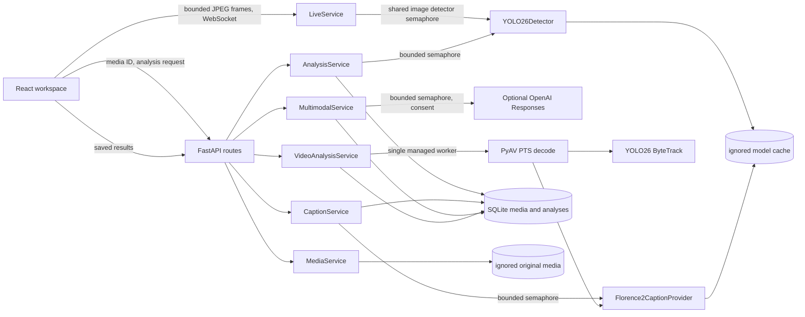

# VisionLab AI architecture — Phase 7

The app remains a modular monolith. FastAPI serves uploaded media and vision results; React consumes the same typed JSON contract. SQLite stores media, analyses, conversations, and accessibility revisions. There is no authentication or external queue in this local development phase.

The upload pipeline validates MIME, signature, file size, image dimensions, and EXIF orientation before storing an original media file under a UUID. Analysis accepts only that UUID. `MediaService.paths` verifies the expected storage name and resolved path. `AnalysisService` opens the saved file, applies EXIF orientation, converts to RGB, and reduces very large sources while preserving aspect ratio. The detector receives a BGR NumPy array as expected by Ultralytics; its returned boxes refer to the reduced input. Dividing those coordinates by the reduced dimensions yields normalized boxes that also align to the correctly oriented original. The browser renders the original with `image-orientation: from-image` and uses the stored oriented dimensions. The canvas and object hit targets share one transformed `.image-layer` with the image, so zoom, pan, resize, and fullscreen apply identically.

YOLO26 initializes lazily behind a lock and stays cached in one API process. An ordinary synchronous FastAPI route runs the CPU or GPU work in the framework thread pool, keeping the event loop responsive. A bounded semaphore caps concurrent analyses; extra attempts return `429` immediately. This is suitable for local development, while multi-process or multi-user deployment would need a shared capacity controller, authentication, and authorization.

Startup creates the `analyses` table and index with `IF NOT EXISTS`, preserving the Phase 2 `media` table. Each analysis gets a new UUID. Success stores the full typed result; a failure stores status and error code. Foreign keys cascade analysis rows when media is deleted. List and get endpoints validate the media ID before querying, and only the newest 100 runs are listed. A model status read never loads weights or downloads anything. The explicit install command is the only automatic model downloader.

The UI has one shared active media ID and analysis ID. Image Analysis and Objects & regions reuse saved detections. Display filters are local React state and do not cause inference. Inference parameters require a new run. Video upload and playback remain available, but Phase 5 cloud tasks reject video explicitly.

## Multimodal image workflows (Phase 5)

`MultimodalService` validates each media UUID and image type through `MediaService.paths`. It decodes an EXIF-oriented image off the event loop, checks stored dimensions, resizes, encodes a metadata-free JPEG data URL, and sends it only after an explicit consent flag. `OpenAIVisionProvider` lazily creates `AsyncOpenAI`, uses Responses structured parsing with `store=False`, and marks itself available only after successful parsing. A bounded semaphore caps concurrent requests. A provider interface allows replacement without changing routes or SQLite contracts. Errors disclose codes and safe messages, never provider payloads or credentials.

New SQLite tables store conversations/messages and accessibility records with foreign keys to media and cascading deletion. A VQA turn commits the user question and successful provider answer together. A failed provider call persists neither. Accessibility records keep generated and edited values separately; edits use optimistic version checks. Decorative `alt=""` is produced locally. A saved Florence caption can be copied into a clearly identified editable suggestion, with no cloud transfer. All SQLite operations in async routes run in a worker thread. The browser stores consent per media ID and never calls cloud inference automatically. No video frame is sent to OpenAI in this phase.

## Uploaded video workflows (Phase 6)

The API validates a media UUID and enqueues a bounded in-process job. A managed thread streams PyAV frames, derives playback-relative timestamps from actual PTS and time base, and samples by elapsed media time. Only sampled frames become resized RGB images; source frames are never retained as a whole-video buffer. FFprobe supplies rotation metadata, and decoded display dimensions must match saved media dimensions. One cached YOLO26 model uses ByteTrack for each analysis; predictor state resets before a new video. Florence caption generation runs only at configured intervals through its existing semaphore. Every sampled frame and caption is stored in an indexed SQLite row, with model provenance, PTS, elapsed time, and optional track IDs. Jobs have persisted revisions, cancellation checkpoints, and restart recovery. Deleting media cascades to video rows.

The browser queries a short frame time window around playback plus compact timeline markers. `requestVideoFrameCallback` uses displayed media timestamps when available; seeking and `timeupdate` provide a fallback. A proximity threshold clears stale boxes between sampled frames, and overlay dimensions follow the native video's letterboxed display region. Video Q&A selects at most six actual frames from a user-chosen range, removes metadata, requires consent, and saves the examined timestamps. Local accessible descriptions come from real Florence captions; optional cloud refinement is user-initiated. This single-process worker is intended for local development, not multi-user deployment or real-time video.

## Live camera workflow (Phase 7)

The React Live Camera route calls `getUserMedia({video, audio:false})` only after a user click. A native `<video>` previews the local stream; `requestVideoFrameCallback`, with a timed fallback, samples up to the chosen rate. A canvas encodes bounded JPEG frames. The browser sends one binary frame envelope at a time and waits for its matching frame result or skip before sending another. It checks `bufferedAmount` and discards old or unrelated results. A shared transformed element keeps preview, normalized canvas boxes, and object hit targets aligned under resizing, mirroring, and fullscreen. Stale results expire, and navigation or page hide stops tracks, timers, and the WebSocket. Snapshot capture is a separate user action that calls the existing image upload API, selecting that saved media for the five established modules.

`LiveService` validates the frame header, JPEG size, decoded dimensions, and session ID off the ASGI event loop. FastAPI checks the explicit localhost Origin allowlist before accepting a socket and limits active sessions, message size, frame rate, and idle time. YOLO runs through the cached image detector and its existing semaphore via `asyncio.to_thread`, sharing capacity with image analysis. The Phase 6 video tracker owns a separate model and a single worker; at most one live/image detector task and one uploaded-video worker may run concurrently. There is no live tracking or automatic frame persistence. Structured live events carry session/frame IDs and timings, never JPEG bytes. The single-process limits are for localhost development and do not replace authentication or cross-process coordination for deployment.

## Florence captioning (Phase 4)

Caption routes are synchronous FastAPI handlers, so Florence loading and generation execute in the framework thread pool. `CaptionService` holds a one-request semaphore and validates uploaded image IDs before decoding EXIF-oriented pixels. Selected-object requests load a saved YOLO analysis and use its server-side detection ID and normalized box to crop; callers cannot supply file paths or coordinates. `Florence2CaptionProvider` loads a pinned local checkpoint lazily under a lock and caches one model instance. Caption records use the existing `analyses` SQLite table with a distinct task value and media foreign key; YOLO queries filter to object-detection records. Media deletion cascades to both. The React image layer renders Florence regions and YOLO boxes in the existing zoom/pan coordinate space, with independent visibility controls.

## Observability layer (Phase 3.5)

`app.core.logging` configures one VisionLab logger with a readable console formatter and a rotating JSONL handler. It does not replace the process root logger or disable Uvicorn server errors. Application access events replace Uvicorn's access lines. A context variable carries a validated request UUID through FastAPI's thread pool into media, model, analysis, and repository events. Each JSONL line has a timestamp, level, component, event, message, and request ID. Structured fields contain measured durations and identifiers, never media bytes or original filenames. See [LOGGING.md](LOGGING.md) for the event contract, configuration, retention, and diagnostic commands.
