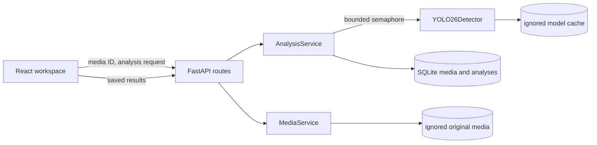

# VisionLab AI architecture — Phase 3

The app remains a modular monolith. FastAPI serves uploaded media and vision results; React consumes the same typed JSON contract. SQLite stores metadata and every completed or failed analysis run. There is no authentication, external queue, or cloud inference in this phase.

The upload pipeline validates MIME, signature, file size, image dimensions, and EXIF orientation before storing an original media file under a UUID. Analysis accepts only that UUID. `MediaService.paths` verifies the expected storage name and resolved path. `AnalysisService` opens the saved file, applies EXIF orientation, converts to RGB, and reduces very large sources while preserving aspect ratio. The detector receives a BGR NumPy array as expected by Ultralytics; its returned boxes refer to the reduced input. Dividing those coordinates by the reduced dimensions yields normalized boxes that also align to the correctly oriented original. The browser renders the original with `image-orientation: from-image` and uses the stored oriented dimensions. The canvas and object hit targets share one transformed `.image-layer` with the image, so zoom, pan, resize, and fullscreen apply identically.

YOLO26 initializes lazily behind a lock and stays cached in one API process. An ordinary synchronous FastAPI route runs the CPU or GPU work in the framework thread pool, keeping the event loop responsive. A bounded semaphore caps concurrent analyses; extra attempts return `429` immediately. This is suitable for local development, while multi-process or multi-user deployment would need a shared capacity controller, authentication, and authorization.

Startup creates the `analyses` table and index with `IF NOT EXISTS`, preserving the Phase 2 `media` table. Each analysis gets a new UUID. Success stores the full typed result; a failure stores status and error code. Foreign keys cascade analysis rows when media is deleted. List and get endpoints validate the media ID before querying, and only the newest 100 runs are listed. A model status read never loads weights or downloads anything. The explicit install command is the only automatic model downloader.

The UI has one shared active media ID and analysis ID. Image Analysis and Objects & regions reuse saved detections. Display filters are local React state and do not cause inference. Inference parameters require a new run. The other AI modules remain planned. Video upload and playback remain available, but Phase 3 analysis rejects video explicitly.
